# Stampede

[](https://hex.pm/packages/stampede)
[](https://github.com/mandar1045/stampede/actions/workflows/ci.yml)
[](https://stampede.hexdocs.pm)
[](https://github.com/mandar1045/stampede/blob/main/LICENSE)

Load testing for Phoenix that speaks Phoenix: Channels, LiveView, HTTP and
plain WebSockets, with scenarios written in Elixir. It load tests AI chat APIs
too, such as Ollama or vLLM.

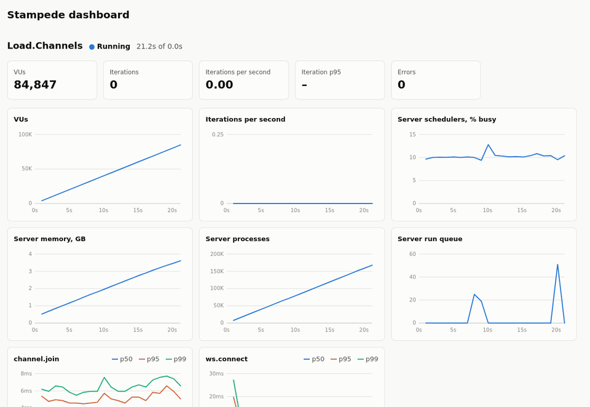

| What I load tested | Server | It held |
|---|---|---|
| Stock Phoenix, with Channels | 16 cores, 128 GB | **2,000,000 users** |
| Stock Phoenix, with Channels | 4 cores, 32 GB | **600,000 users** |
| A real open source Phoenix product, 100 users in each channel | 4 cores, 32 GB | **50,000 users for 10 minutes**, 80.9 million messages delivered |
| A chat app that keeps every message in Postgres, 100 million of them | 16 cores, 128 GB, with Postgres on 8 more | **40,000 users**, each one reading and writing the database |

Every run, its scripts and every number it measured are in
[`bench/million`](https://github.com/mandar1045/stampede/tree/main/bench/million).

[Quick start](#quick-start) ·
[Find your limit](#find-your-limit) ·
[Inside your app](#see-inside-your-app) ·
[Record a session](#record-a-session) ·
[Watch it anywhere](#watch-it-anywhere) ·
[Results](#what-it-has-held) ·
[Reference](#what-it-speaks) ·
[Guides](#guides)

## Why I built this

I wanted to see how a real-time Phoenix app held up with hundreds of people in
one channel. Generic load testers see a channel as just another WebSocket, so
the scripts end up building `phx_join` messages, refs and heartbeats by hand.
And "how do I load test LiveView?" keeps coming up on Elixir Forum without a
good answer.

So I wrote the tool I wanted. Stampede already knows the Channels protocol and
how a LiveView session starts, so a scenario is just what a user does. Every
virtual user (VU) is a BEAM process, so one laptop holds thousands of
connections, and when it can't, more machines join over Erlang distribution.

## Quick start

With [Igniter](https://hexdocs.pm/igniter), which also writes a first scenario
to `loadtest/home.exs`:

```console
$ mix igniter.install stampede
```

Or add it yourself, and you'll need Elixir 1.18 or newer:

```elixir
{:stampede, "~> 1.4", only: [:dev, :test]}
```

A scenario is a module with a `run/1`, which each VU calls over and over.
`mix stampede.gen.scenario Lobby --channels` writes one for you (`--live`,
`--websocket` and plain HTTP too). By hand, it looks like this:

```elixir
defmodule MyApp.Load.Lobby do
  use Stampede.Scenario

  @impl true
  def options do
    [
      stages: [{[second: 30], 500}, {[minute: 1], 500}, {[second: 10], 0}],
      thresholds: [{"channel.join", p95: 250}, {"iteration.errors", count: 0}]
    ]
  end

  @impl true
  def run(vu) do
    {:ok, socket} = Stampede.Channels.connect("ws://localhost:4000/socket")
    {:ok, _reply} = Stampede.Channels.join(socket, "room:lobby")

    for _ <- 1..10 do
      {:ok, _reply} = Stampede.Channels.push(socket, "room:lobby", "new_msg", %{body: "hi from #{vu.id}"})
      Process.sleep(1_000)
    end
  end
end
```

Save it as `loadtest/lobby.exs`, and run it with the dashboard on
http://127.0.0.1:4040:

```console
$ mix stampede.run loadtest/lobby.exs --dashboard
```

That ramps up to 500 VUs over 30 seconds, holds them for a minute and ramps
down. At the end you get a summary. This one is 6,000 VUs across three nodes,
all on my laptop along with the Phoenix app:

```
Demo.Chat ran for 15.0s

  metric          count   rate/s     mean     p50      p90      p95      p99       max
  channel.join     6000   399.89  10.72ms  5.49ms  18.59ms  31.90ms  97.77ms  103.81ms
  channel.push   139348  9287.39   2.56ms   854µs   6.84ms  11.27ms  22.25ms   55.84ms
  ws.connect       6000   399.89  16.28ms 11.50ms  28.29ms  35.25ms 134.64ms  209.06ms

  thresholds
    pass  channel.join p95 <= 500.00ms (31.90ms)
    pass  iteration.errors count <= 0 (0)
```

A failed threshold makes the task exit with status 1, so it works in CI as it
is.

## Find your limit

The real question is usually "how many users can it handle?", so Stampede
answers it directly:

```console
$ mix stampede.run loadtest/lobby.exs --find-limit
```

It adds users a step at a time and checks your thresholds over each step. The
first step that breaks one ends the run, and you get the most users that held,
and why the next step didn't. Each step ramps for 5 seconds and holds for 30 by
default, and `--start`, `--step`, `--up-to` and `--hold` change that. Here's
the report of a run that climbed to 600,000 users, with every step that held
shaded green:

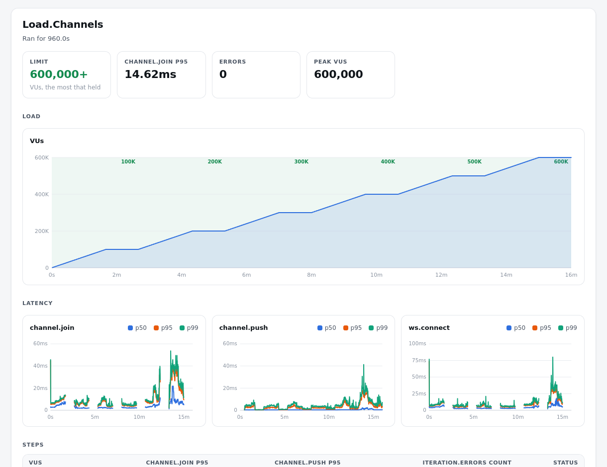

`--badge badge.svg` writes a badge with the result, for your README:


## See inside your app

A load test tells you when your app got slow, not why. With `--probe`,
Stampede watches the app from the inside while the test runs, with no changes
to it. The app only needs a node name and a cookie:

```console
$ elixir --name app@127.0.0.1 --cookie secret -S mix phx.server
$ elixir --name loader@127.0.0.1 --cookie secret -S mix stampede.run loadtest/lobby.exs --probe app@127.0.0.1
```

You get the server's schedulers, memory, processes, run queue and longest
message queues every second. Phoenix requests, channel events, LiveView events
and Ecto queries come back as `server.*` metrics you can set thresholds on.
This is what the probe saw on the way to 600,000 users, with 1.2 million
processes on 4 cores:

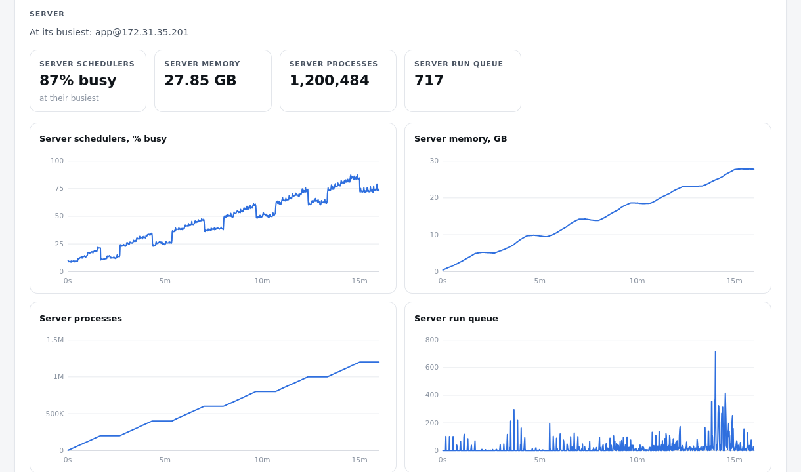

It watches your database too: how long queries waited for a connection from
the Ecto pool, and for Postgres, its own commits, writes, reads and what its
sessions were waiting on, over one connection of its own outside your pool.
When a `--find-limit` step fails, the verdict puts it together. Here it is on
my laptop, with Postgres held to a fifth of a CPU so it would be the limit:

```
  limit
    Held 250 VUs. At 350 VUs, iteration.errors count was 64, over 0. Queries waited up to
    171.94ms for one of the database pool's 2 connections. Postgres was mostly busy running
    queries. The app's schedulers were only 16% busy, so the database was the limit, not the app.
```

The agent costs a little, about 6 points of CPU in the 600,000 run, and its
code is removed when the test ends. The
[guide](https://stampede.hexdocs.pm/probe.html) covers real deployments.

## Record a session

Writing a LiveView scenario by hand means looking up event names and form
fields. Instead, click through your app once and let Stampede write it:

```console
$ mix stampede.record SignIn
```

It starts your app. Use it in the browser as a user would, then press Enter.
Here it's recording a sign-in on a `phx.gen.auth` app:

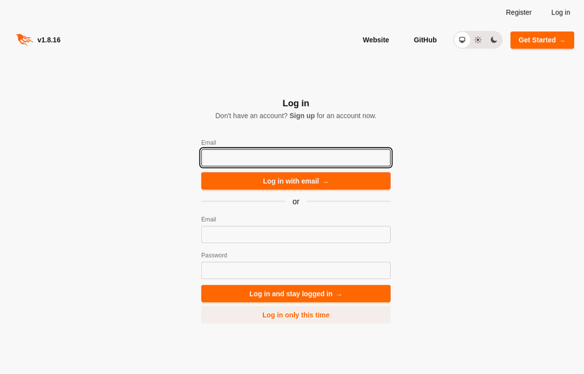

The scenario it writes has your clicks, forms, uploads, channels, navigation
and pauses. Signing in goes through the real form, with a fresh CSRF token and
session for each VU, and passwords and tokens become `"CHANGE_ME"` so they
don't end up in a file you might commit. The
[guide](https://stampede.hexdocs.pm/recording.html) shows a full recorded
scenario.

## Watch it anywhere

**The dashboard.** `--dashboard` serves the page in the animation at the top
on http://127.0.0.1:4040. It updates every second, and shows the full results
when the run is over.

**Your app's LiveDashboard.** Add Stampede's page to the route:

```elixir
live_dashboard "/dashboard",
  additional_pages: [stampede: Stampede.LiveDashboard]
```

Any run with `--probe` then shows up live in a Stampede tab, next to the
dashboard's processes and ports, and stays there after the load test has gone:

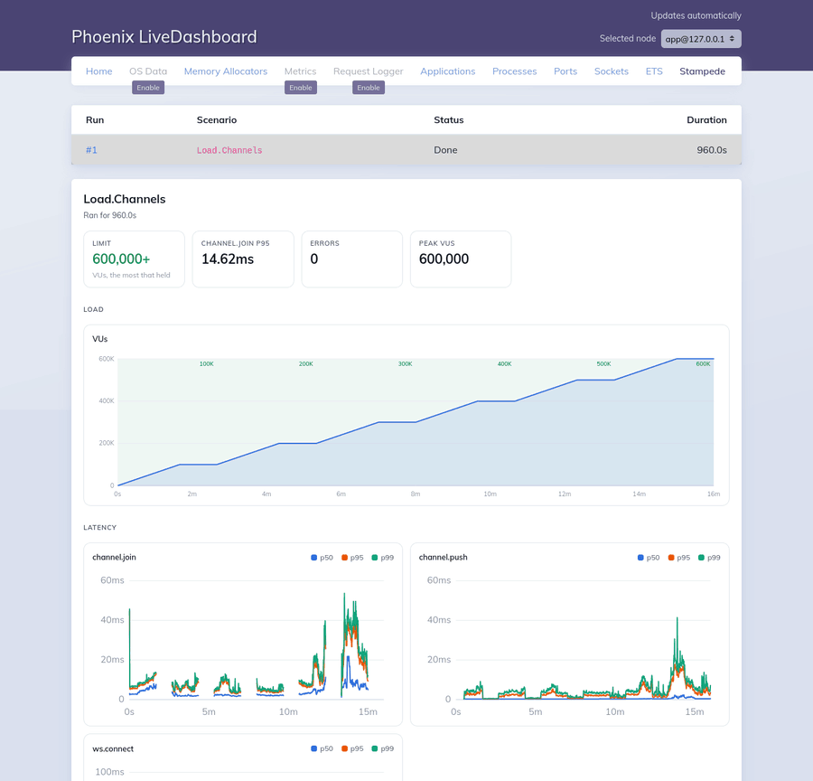

**Livebook.** [](https://livebook.dev/run?url=https%3A%2F%2Fgithub.com%2Fmandar1045%2Fstampede%2Fblob%2Fmain%2Fnotebooks%2Fload_test.livemd)
Add Stampede and Kino, and pick **Load test** from the **+ Smart** menu. You
fill in what to test, a page, a LiveView, a channel or an AI chat API, and how
many users, and it writes and runs the scenario:

```elixir
Mix.install([{:stampede, "~> 1.4"}, {:kino, "~> 0.14"}])
```

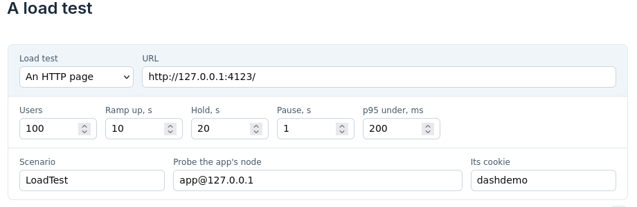

Any `Stampede.Result` shows as the report in a notebook, so a saved run looks
like this:

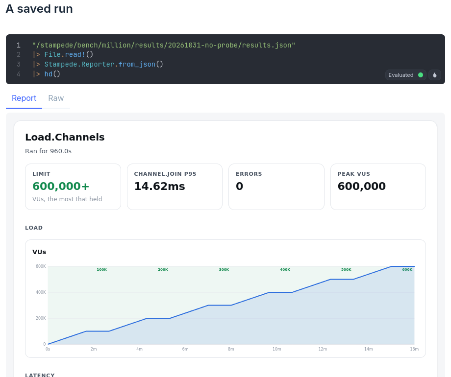

**A file.** `--html report.html` writes the same charts into one file with
nothing else to load, for CI to keep. `--out results.json` saves everything,
and `mix stampede.report results.json` turns a saved run back into the report.

## What it has held

The first four ran on AWS with stock settings, and every user behaved like a
real client: joining, sending heartbeats every 30 seconds and a message every
30 to 60. The commands, logs and reports are in
[`bench/million`](https://github.com/mandar1045/stampede/tree/main/bench/million).

### 2,000,000 users on stock Phoenix

One 16-core, 128 GB server, with Stampede on eight smaller machines, stepping
up 250,000 users at a time. A step only passed with joins and messages under 1
second at p95 and no errors:

| Users | Server CPU | Server memory |
|---:|---:|---:|
| 1,000,000 | 37–48% | 52 GB |
| 1,500,000 | 54–60% | 77 GB |
| **2,000,000** | **78–84%** | **103 GB** |

Memory came to about 51 KB a user, so the CPU set the limit: two million users
send well over 100,000 heartbeats and messages a second. This is the dashboard
at the end of the 2,000,000 step:

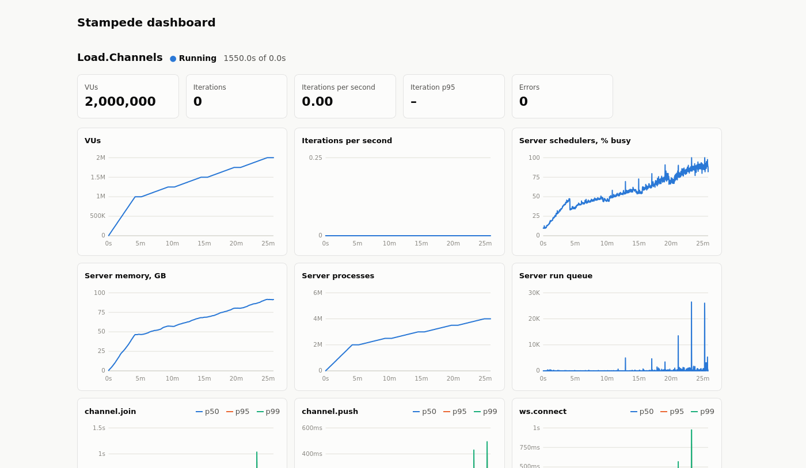

The best-known Phoenix number is the core team's 2 million connections from
2015, on a 40-core machine, where each connection joined and then sat idle.
This was 16 cores, with every user active.

### 600,000 users on 4 cores

Stock Phoenix on one 4-core, 32 GB server held 600,000 users with no errors.
At the 600,000 step, joins took 31ms and messages 10ms at p95, at 76% CPU. Its
memory was 98% full by then, about 47 KB a connection, so that's as far as
this server goes. Here's that run replayed from its saved results in the
dashboard, with its report [above](#find-your-limit):

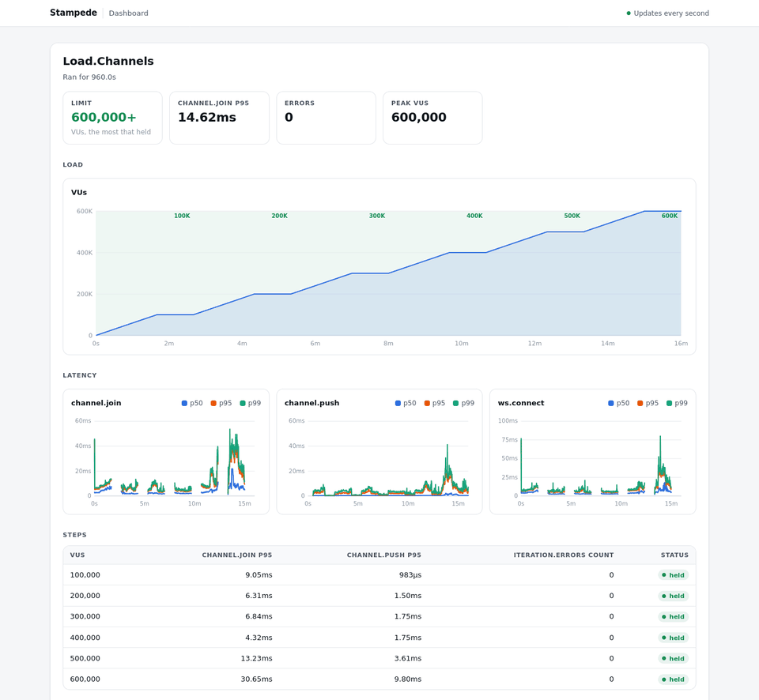

### 50,000 users on a real product

An open source real-time server built with Phoenix, self-hosted from its
official release on the same 4 cores. With 100 users in each channel and every
message going to all of them, it held 50,000 users for 10 minutes, delivered
80.9 million messages, and round trips stayed at 5.71ms at p95.

I checked it against things that don't come from Stampede. The server's own
metrics in Grafana counted 50,001 users, the 50,000 plus one real browser:


And a real client in Firefox, in the same channel as the load test, received
its messages:

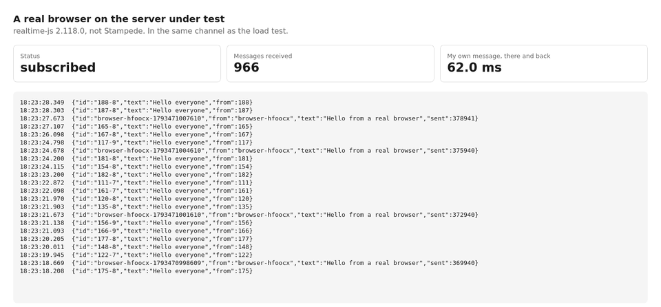

99.996% of the messages that should've arrived did, and the server logged no
errors until the users disconnected at the end. There are videos of
[the dashboard](https://github.com/mandar1045/stampede/blob/main/bench/million/results/20261031-realtime-hold-50k/videos/stampede-dashboard.mp4),
[LiveDashboard inside the server](https://github.com/mandar1045/stampede/blob/main/bench/million/results/20261031-realtime-hold-50k/videos/livedashboard.mp4)
and the rest in the repo, and the
[case study](https://stampede.hexdocs.pm/supabase_realtime.html) has what this
one workload doesn't show.

### 40,000 users with a real database

The runs above barely touch a database, so this is a chat app that keeps every
message in Postgres: a fresh `mix phx.new` app with Ecto's default pool of 10,
and Postgres 17 on its default settings on a machine of its own, seeded with 1
million users, 10,000 rooms and 100 million messages. Each user joins a room,
which reads its latest 50 messages, then sends a message, written before the
reply comes back, or scrolls up for older ones.

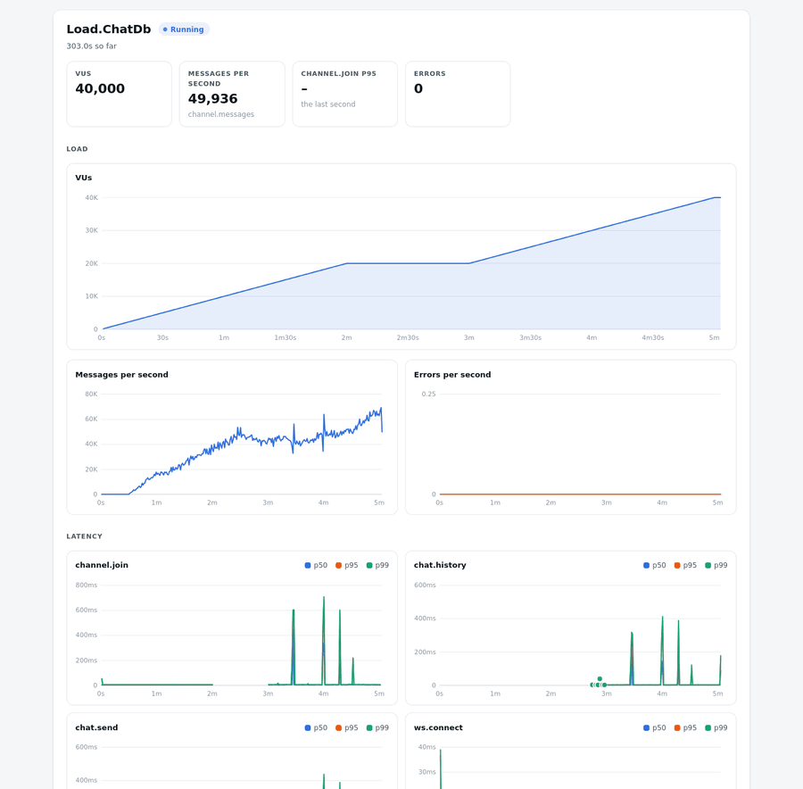

| Users | Join p95 | Send p95 | Scroll up p95 | Errors |
|---:|---:|---:|---:|---:|
| 20,000 | 4.58ms | 3.20ms | 38.96ms | 0 |
| **40,000** | **6.31ms** | **178.14ms** | **167.77ms** | **0** |

Much smaller than 2,000,000, as it should be: every user reads and writes a
real database. Past 40,000 it hit three limits at once: the app's schedulers
were 96% busy, queries waited for one of the pool's 10 connections, and
Postgres was mostly waiting to write its log to disk. Working that out by hand
is what made me teach `--probe` to watch the database.

### 12,000 LiveView users on my laptop

A fresh Phoenix app in production mode, with a LiveView page where every user
loads the page, joins, clicks and stays for about 20 seconds, with the app and
the load test sharing my laptop:

| Users | Join p95 | Click p95 |
|---:|---:|---:|
| 1,000 | 2.67ms | 1.41ms |
| 4,000 | 3.46ms | 1.83ms |
| 8,000 | 6.57ms | 5.60ms |
| 12,000 | 11.97ms | 11.05ms |

No errors, and Stampede never found where it breaks.

## What it speaks

**Phoenix Channels.** `Stampede.Channels` does what the JavaScript client
does: `connect/2` with either serializer, `join/4`, `push/5` and `leave/3`
that wait for the reply, `cast/4`, `await/4` for broadcasts, heartbeats and
binary payloads. It records `ws.connect`, `channel.join`, `channel.push`,
`channel.leave` and `channel.messages`. There are guides for
[Presence](https://stampede.hexdocs.pm/presence.html) and
[Absinthe subscriptions](https://stampede.hexdocs.pm/absinthe.html).

**LiveView.** `Stampede.LiveView` loads the page and joins the LiveView on it
with its CSRF token and cookies, like a browser:

```elixir
{:ok, view} = Stampede.LiveView.connect("http://localhost:4000/posts/new")
{:ok, _reply} = Stampede.LiveView.change(view, "validate", %{"post" => %{"title" => "Hi"}})
{:ok, _reply} = Stampede.LiveView.submit(view, "save", %{"post" => %{"title" => "Hi there"}})
{:ok, _view} = Stampede.LiveView.navigate(view, "/posts")
```

`click/4`, `patch/3`, `upload/4` and `await/2` cover the rest, and pages
behind a login work through redirects or the real form, as the
[login guide](https://stampede.hexdocs.pm/login.html) shows.

**HTTP.** `Stampede.HTTP.get/2` and `post/2` keep each VU's connections open
like a browser, and keep cookies with `cookies: true`. They record
`http.request`.

**Plain WebSockets.** `Stampede.WebSocket` is for servers that don't use
Channels, such as a `WebSock` handler or a GraphQL endpoint.

**AI chat APIs.** `Stampede.LLM` load tests anything with an OpenAI-style chat
API, such as Ollama, vLLM or llama.cpp. It records time to first token, the
gaps between tokens and tokens per second. On 8 CPU cores, Ollama held 6
people chatting at once with a small model, and 12 with
`OLLAMA_NUM_PARALLEL=4`. The [guide](https://stampede.hexdocs.pm/llm.html) has
a one-file script.

## Writing scenarios

**Load.** `stages` moves the number of VUs in straight lines, and
`vus: 100, duration: [minute: 1]` holds them. VUs wait for their last iteration
before the next, so a slow server quietly gets less load. `rate` keeps starting
iterations on schedule however long they take:

```elixir
[rate: 200, duration: [minute: 5], max_vus: 1_000]
```

`--vus`, `--rate` and `--duration` override them on the command line, and
`--parallel` runs several scenarios at once, such as readers and writers.

**Checks and thresholds.** Checks are assertions that don't stop the
iteration. Thresholds are what a run has to stay within to pass:

```elixir
Stampede.check("status is 200", response.status == 200)

thresholds: [
  {"channel.join", p95: 250, max: 2_000},
  {"status is 200", failed_rate: 0.01},
  {"iteration.errors", count: 0}
]
```

Timings have `min`, `mean`, `p50`, `p90`, `p95`, `p99` and `max` in
milliseconds, accurate to 1% however many samples there are. Add your own with
`Stampede.measure/2`, `Stampede.increment/2` and `Stampede.record/3`.

**Errors.** When an iteration raises, it's counted under `iteration.errors`
and listed in the summary, and the VU starts its next one. Sockets opened in an
iteration are closed when it ends.

## In CI and beyond

**Your test suite.** `Stampede.ExUnit` fails a test when a threshold fails:

```elixir
test "the lobby holds 200 users" do
  assert_load(MyApp.Load.Lobby, vus: 200, duration: [second: 30])
end
```

**Regressions.** `mix stampede.compare main.json branch.json --max-regression 10`
compares two saved runs and fails if a percentile got more than 10% slower.

**More machines.** One machine runs out of CPU or ports long before a good
Phoenix server does. Start a node on each extra machine and pass
`--nodes worker@host`. VUs are split evenly and the metrics merged. The
[guide](https://stampede.hexdocs.pm/distributed.html) covers networks.

**A plain script.** `Mix.install([{:stampede, "~> 1.4"}])` and
`Stampede.run(Lobby, vus: 100, duration: [minute: 1])` work without a Mix
project.

**Your own metrics.** There are `:telemetry` events for every timing, counter
and check, and for each second of a run.

## Guides

  * [Pages behind a login](https://stampede.hexdocs.pm/login.html)
  * [Phoenix Presence](https://stampede.hexdocs.pm/presence.html)
  * [GraphQL subscriptions with Absinthe](https://stampede.hexdocs.pm/absinthe.html)
  * [Load tests in CI](https://stampede.hexdocs.pm/ci.html)
  * [Spreading the load over machines](https://stampede.hexdocs.pm/distributed.html)
  * [Load testing AI chat APIs](https://stampede.hexdocs.pm/llm.html)
  * [Seeing inside your app](https://stampede.hexdocs.pm/probe.html)
  * [Watching a run in Prometheus and Grafana](https://stampede.hexdocs.pm/prometheus.html)
  * [Recording a session](https://stampede.hexdocs.pm/recording.html)
  * [Case study: Supabase Realtime](https://stampede.hexdocs.pm/supabase_realtime.html)

## Why not k6, Locust or Artillery?

They're good tools, especially for plain HTTP APIs. For Phoenix, though, they
see a channel as just another WebSocket, so you end up writing the protocol
yourself: joins, refs, replies and heartbeats. LiveView is harder still, since
the socket needs tokens from a page load before it can connect. Stampede
handles all of that, and because scenarios are Elixir, you can reuse your own
modules and test data in them.

## Status and roadmap

Stampede is young. Its test suite runs real load tests against a Phoenix app
on every change, but expect rough edges, and please tell me when you hit one.
What I'm working on next:

  * LiveView at the same scale as Channels
  * A command line tool that doesn't need Elixir installed
  * More protocols: Socket.IO and GraphQL over WebSocket

Ideas and questions go in
[Discussions](https://github.com/mandar1045/stampede/discussions), bugs in the
issues, and [CONTRIBUTING.md](https://github.com/mandar1045/stampede/blob/main/CONTRIBUTING.md)
explains how to work on Stampede itself.

## License

Copyright 2026 Mandar Joshi

Licensed under the Apache License, Version 2.0, found in the LICENSE file.
