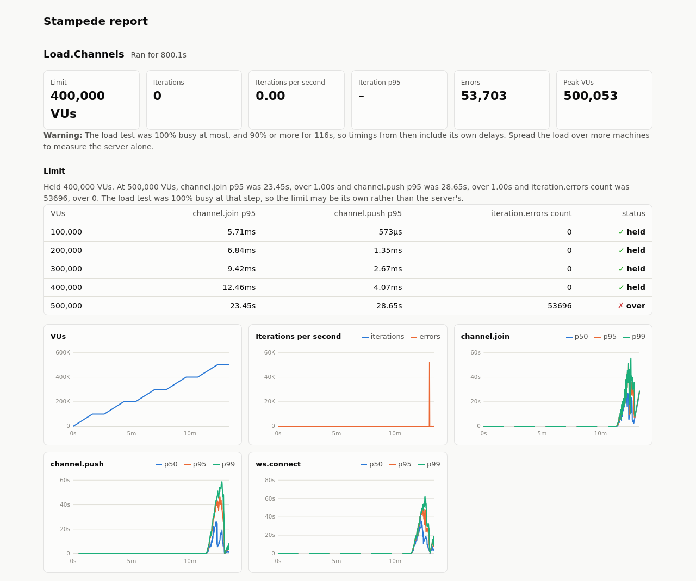

# Stampede

[](https://hex.pm/packages/stampede)
[](https://github.com/mandar1045/stampede/actions/workflows/ci.yml)
[](https://stampede.hexdocs.pm)
[](https://github.com/mandar1045/stampede/blob/main/LICENSE)

Load testing for Phoenix that speaks Phoenix: Channels, LiveView, HTTP and
plain WebSockets, with scenarios written in Elixir.


## Why I built this

I wanted to see how a real-time Phoenix app held up with hundreds of people
in one channel. Generic load testers see a channel as just another
WebSocket, so the scripts end up building `phx_join` messages, refs and
heartbeats by hand. Chaperon, the Elixir load tester I found, hasn't had a
release since 2020. And "how do I load test LiveView?" keeps coming up on
Elixir Forum without a good answer.

So I wrote the tool I wanted. Stampede already knows the Channels protocol
and how a LiveView session starts, so a scenario is just what a user does.
Every virtual user (VU) is a BEAM process, which means one laptop can hold
thousands of connections, and when it can't, more machines can join over
Erlang distribution. Scenarios are plain Elixir modules, so they can call
your own code.

## Installation

The quickest way is [Igniter](https://hexdocs.pm/igniter), which also drops a
first scenario into `loadtest/home.exs`:

```console
$ mix igniter.install stampede
```

Without Igniter, add it to your dependencies:

```elixir
def deps do
  [
    {:stampede, "~> 1.2", only: [:dev, :test]}
  ]
end
```

You'll need Elixir 1.18 or newer.

## Your first load test

`mix stampede.gen.scenario Lobby --channels` gives you something to start
from. There's also `--live` and `--websocket`, and no flag gets you plain
HTTP. Written by hand, a channels scenario looks like this:

```elixir
defmodule MyApp.Load.Lobby do
  use Stampede.Scenario

  @impl true
  def options do
    [
      stages: [{[second: 30], 500}, {[minute: 1], 500}, {[second: 10], 0}],
      thresholds: [{"channel.join", p95: 250}, {"iteration.errors", count: 0}]
    ]
  end

  @impl true
  def run(vu) do
    {:ok, socket} = Stampede.Channels.connect("ws://localhost:4000/socket")
    {:ok, _reply} = Stampede.Channels.join(socket, "room:lobby")

    for _ <- 1..10 do
      {:ok, _reply} = Stampede.Channels.push(socket, "room:lobby", "new_msg", %{body: "hi from #{vu.id}"})
      Process.sleep(1_000)
    end
  end
end
```

Save it as `loadtest/lobby.exs` and run it:

```console
$ mix stampede.run loadtest/lobby.exs
```

That ramps up to 500 VUs over 30 seconds, holds them for a minute and ramps
back down, with a progress line every second. Each VU calls `run/1` over and
over. At the end you get a summary. This one is from a run with 6,000 VUs
across three nodes, all on my laptop along with the Phoenix app:

```
Demo.Chat ran for 15.0s

  metric          count   rate/s     mean     p50      p90      p95      p99       max
  channel.join     6000   399.89  10.72ms  5.49ms  18.59ms  31.90ms  97.77ms  103.81ms
  channel.push   139348  9287.39   2.56ms   854µs   6.84ms  11.27ms  22.25ms   55.84ms
  ws.connect       6000   399.89  16.28ms 11.50ms  28.29ms  35.25ms 134.64ms  209.06ms

  thresholds
    pass  channel.join p95 <= 500.00ms (31.90ms)
    pass  iteration.errors count <= 0 (0)
```

If a threshold fails, the task exits with status 1, so it works in CI as it
is.

## Watching a run

Add `--dashboard` and open http://127.0.0.1:4040:

```console
$ mix stampede.run loadtest/lobby.exs --dashboard
```

That's the page in the animation at the top. It updates every second while
the test runs, and shows the full results when it's done.

## How many users can it handle?

That's usually the real question, so Stampede can answer it directly:

```console
$ mix stampede.run loadtest/lobby.exs --find-limit
```

Instead of a fixed load, it adds users a step at a time and checks your
thresholds over each step. The first step that breaks one ends the run, and
the summary tells you the most users that passed.

I tried it on a fresh Phoenix app, running in production mode, with a
LiveView page where every user loads the page, joins, clicks and stays for
about 20 seconds. The limit was a p95 under 500ms for joins and under 100ms
for clicks, with no errors:

```console
$ mix stampede.run loadtest/counter.exs --find-limit --start 1000 --step 1000 --up-to 12000 --hold 20s
```

```
  limit
    Held 12,000 VUs, the most it was asked to try

  VUs     live.join p95  live.event p95  iteration.errors count  status
  1,000          2.67ms          1.41ms                       0    pass
  4,000          3.46ms          1.83ms                       0    pass
  8,000          6.57ms          5.60ms                       0    pass
  12,000        11.97ms         11.05ms                       0    pass
```

So with the app and the load test sharing my laptop, Phoenix held 12,000
LiveView users with joins under 12ms at p95 and not a single error, and
Stampede never found where it breaks.

Then I moved it to AWS: stock Phoenix on one 4-core, 32 GB server, and
Stampede on a second machine of the same size. Every user behaves like
Phoenix's JavaScript client: it joins a chat room, sends a heartbeat every 30
seconds and a message every 30 to 60, and stays. Each step ramps over 100
seconds:

```console
$ mix stampede.run loadtest/channels.exs --find-limit --start 100000 --step 100000 --up-to 800000 --hold 60s
```

```
 159.6s  vus: 100000  iterations: 0  errors: 0  load test busy: 16%
   step  100,000 VUs: held
 319.4s  vus: 200000  iterations: 0  errors: 0  load test busy: 29%
   step  200,000 VUs: held
 479.1s  vus: 300000  iterations: 0  errors: 0  load test busy: 42%
   step  300,000 VUs: held
 639.0s  vus: 400000  iterations: 0  errors: 0  load test busy: 55%
   step  400,000 VUs: held
 799.0s  vus: 500000  iterations: 0  errors: 53663  load test busy: 100%
   step  500,000 VUs: over the limit

  warning
    The load test was 100% busy at most, and 90% or more for 116s, so
    timings from then include its own delays. Spread the load over more
    machines to measure the server alone.

  limit
    Held 400,000 VUs. At 500,000 VUs, channel.join p95 was 23.45s, over
    1.00s and channel.push p95 was 28.65s, over 1.00s and iteration.errors
    count was 53696, over 0. The load test was 100% busy at that step, so
    the limit may be its own rather than the server's

  VUs      channel.join p95  channel.push p95  iteration.errors count  status
  100,000            5.71ms             573µs                       0    pass
  200,000            6.84ms            1.35ms                       0    pass
  300,000            9.42ms            2.67ms                       0    pass
  400,000           12.46ms            4.07ms                       0    pass
  500,000            23.45s            28.65s                   53696    FAIL
```

400,000 users, no errors, joins in 12ms and messages in 4ms at p95. While it
held them, the Phoenix server used 24% of its CPU and 18 GB of memory, and
didn't log a single warning. At 500,000 it was the machine running Stampede
that ran out of CPU, and the summary says so rather than blaming the server.
Here's the HTML report from the same run:



Everything you need to run it yourself, and every number it measured, is in
[`bench/million`](https://github.com/mandar1045/stampede/tree/main/bench/million).
The goal is still a million, once I have more load machines.

Each step ramps for 5 seconds and holds for 30 by default. `--start`,
`--step`, `--up-to` and `--hold` change that, and `find_limit: [by: :rate]`
in a scenario's options steps up the arrival rate instead of users.
It's new in 1.2, so the options and the report may still change a little.
`--badge badge.svg` writes a badge with the result, for your README:


## Scenarios

A scenario is a module that implements `Stampede.Scenario`. Only `run/1` is
required:

  * `run/1` is one iteration of a VU. It gets a `Stampede.VU` with the VU's
    `id`, its `iteration` count and the `data` returned by `setup/1`.
  * `options/0` returns the default options of the run.
  * `setup/1` runs once, before any VU starts. It's the place to create
    accounts or sign tokens that every VU needs.

When an iteration raises, the error is counted under `iteration.errors` and
listed in the summary, and the VU simply starts its next iteration. Sockets
opened during an iteration are closed when it ends, so nothing leaks from one
iteration to the next.

## VUs or a rate

There are two ways to apply load: keep a number of VUs busy, or start
iterations at a fixed rate.

`stages` is a list of `{duration, target}` tuples, each moving the number of
VUs in a straight line to its target. `vus: 100, duration: [minute: 1]` just
holds 100 VUs for a minute. Durations are milliseconds, or anything
`Kernel.to_timeout/1` takes, like `[second: 30]`.

The catch with VUs is that each one waits for its last iteration to finish
before starting the next. When your server slows down, the load quietly eases
off with it, and real users don't do that. `rate` keeps starting iterations
on schedule, however long they take:

```elixir
[rate: 200, duration: [minute: 5], max_vus: 1_000]
[rate_stages: [{[minute: 1], 500}, {[minute: 5], 500}]]
```

VUs are started as needed and reused, keeping their connections. `max_vus`
caps how many iterations can be in flight, and the ones that can't start are
counted as `iterations.dropped`.

On the command line, `--vus 100` or `--rate 200` with `--duration 1m`
override whatever the scenario says.

VUs that aren't needed anymore, during a ramp down or at the end, are stopped
right away. Set `graceful_stop: [second: 30]` to let them finish their
current iteration first, so it gets recorded instead of cut off.

## Mixing kinds of traffic

Real traffic is rarely one kind of user. Usually lots of people are reading
while a few are writing. `--parallel` runs every scenario you give it at the
same time, each with its own load and thresholds:

```console
$ mix stampede.run loadtest/reading.exs loadtest/posting.exs --parallel
```

From code, it's `Stampede.run_parallel([Reading, Posting])`, which returns
one result per scenario.

## Checks and thresholds

Checks are assertions that don't stop the iteration when they fail:

```elixir
{:ok, response} = Stampede.HTTP.get("http://localhost:4000/api/posts")
Stampede.check("status is 200", response.status == 200)
```

Thresholds are the limits a run has to stay within to pass:

```elixir
thresholds: [
  {"channel.join", p95: 250, max: 2_000},
  {"status is 200", failed_rate: 0.01},
  {"iteration.errors", count: 0}
]
```

Timings have `min`, `mean`, `p50`, `p90`, `p95`, `p99` and `max`, in
milliseconds. Checks have `failed` and `failed_rate`, and every metric has
`count` and `rate`, per second. Percentiles stay within 1% of the exact
value, however many samples a run collects.

## In your test suite

If you'd rather keep load tests with your other tests, `Stampede.ExUnit`
fails a test when a threshold fails, with the run's summary in the failure
message:

```elixir
Code.require_file("../loadtest/lobby.exs", __DIR__)

defmodule MyApp.LoadTest do
  use ExUnit.Case
  import Stampede.ExUnit

  @moduletag :load

  test "the lobby holds 200 users" do
    assert_load(MyApp.Load.Lobby, vus: 200, duration: [second: 30])
  end
end
```

Put `ExUnit.start(exclude: [:load])` in `test/test_helper.exs`, so they only
run with `mix test --only load`.

## Metrics

Every scenario records `iteration`, `iteration.errors`, `iterations.dropped`
and `vu.crashes`, and each client below records its own. Add yours with
`Stampede.measure/2`, `Stampede.record/3`, `Stampede.increment/2` and
`Stampede.check/2`. Timing a broadcast round trip, for example:

```elixir
Stampede.measure("broadcast.roundtrip", fn ->
  :ok = Stampede.Channels.cast(socket, "room:lobby", "shout", %{from: vu.id})
  {:ok, _payload} = Stampede.Channels.await(socket, "room:lobby", "shout", match: &(&1["from"] == vu.id))
end)
```

## HTTP

`Stampede.HTTP` records requests as `http.request`, and counts transport
errors and responses of 400 or more under `http.request.errors`:

```elixir
{:ok, %{status: 200, body: body}} = Stampede.HTTP.get("http://localhost:4000/api/posts")
{:ok, %{status: 201}} = Stampede.HTTP.post("http://localhost:4000/api/posts", json: %{title: "Hi"})
```

Each VU keeps its connections open between requests, like a browser, and
reconnects when the server has closed one. On my laptop, against a Phoenix
app on the same machine, 2,000 GET requests a second for 10 seconds held
their rate with a p99 of 1.56ms.

## Phoenix Channels

`Stampede.Channels` does what the JavaScript client does:

  * `connect/2` with params, headers and either serializer (`"2.0.0"` or `"1.0.0"`)
  * `join/4`, `push/5` and `leave/3`, which wait for the reply
  * `cast/4` for events the channel doesn't reply to
  * `await/4` for pushes and broadcasts from the server, with an optional
    `:match` function to pick one out of many
  * heartbeats, every 30 seconds by default
  * binary payloads, as `{:binary, data}`, with the `"2.0.0"` serializer
  * a `:serializer` option for servers that add message types of their own,
    such as custom binary frames

It records `ws.connect`, `ws.disconnects`, `channel.join`, `channel.push`,
`channel.leave` and `channel.messages`, plus an `.errors` counter for each
kind of request. A push to a channel that crashes fails right away with
`{:error, :channel_crashed}`, instead of waiting for its timeout.

[Phoenix Presence](guides/presence.md) and
[Absinthe subscriptions](guides/absinthe.md) both run over channels, and
each has a guide.

## LiveView

`Stampede.LiveView` loads the page, then joins the LiveView on it with the
page's CSRF token and cookies, just like a browser:

```elixir
@impl true
def run(_vu) do
  {:ok, view} = Stampede.LiveView.connect("http://localhost:4000/posts/new")
  {:ok, _reply} = Stampede.LiveView.change(view, "validate", %{"post" => %{"title" => "Hi"}})
  {:ok, _reply} = Stampede.LiveView.submit(view, "save", %{"post" => %{"title" => "Hi there"}})
  {:ok, _reply} = Stampede.LiveView.click(view, "like", %{"id" => "1"})
  {:ok, _view} = Stampede.LiveView.navigate(view, "/posts")
end
```

`click/4`, `change/4` and `submit/4` send what `phx-click`, `phx-change` and
`phx-submit` would, and give back whatever `handle_event/3` replied. Pass
`target: 1` to talk to a component, like `phx-target` does. `await/2` waits
for updates the LiveView pushes on its own.

`patch/3` and `navigate/3` work like `<.link patch>` and `<.link navigate>`,
reusing the socket when LiveView allows it. If an event makes the LiveView
navigate, you get `{:error, {:live_redirect, %{"to" => to}}}` back, the same
as with `Phoenix.LiveViewTest`, and `navigate/3` will follow it.

`upload/4` sends files to a `live_file_input`, in chunks over the same
socket, so you can submit the form with them afterwards:

```elixir
photo = :crypto.strong_rand_bytes(200_000)
:ok = Stampede.LiveView.upload(view, "avatar", [%{name: "me.jpg", content: photo}])
{:ok, _reply} = Stampede.LiveView.submit(view, "save", %{"user" => %{"name" => "jo"}})
```

Pages behind a login work too. `connect/2` follows redirects and keeps the
cookies they set, so a route that signs in a test user and redirects is
enough, and the [login guide](guides/login.md) walks through it. LiveView
runs record `live.page`, `live.join`, `live.event`, `live.patch`,
`live.navigate` and `live.upload`.

## Plain WebSockets

For servers that don't use Phoenix Channels, like a `WebSock` handler or a
GraphQL subscription endpoint, there's `Stampede.WebSocket`:

```elixir
{:ok, ws} = Stampede.WebSocket.connect("ws://localhost:4000/ws")
:ok = Stampede.WebSocket.send(ws, JSON.encode!(%{subscribe: "prices"}))
{:ok, {:text, text}} = Stampede.WebSocket.await(ws, match: &match?({:text, "{\"price\"" <> _}, &1))
```

It answers pings and holds on to the frames it receives until `await/2`
reads them, even after the server has closed the connection. It records
`ws.connect`, `ws.disconnects`, `ws.messages` and `ws.messages.sent`.

## Results

`Stampede.run/2` returns a `Stampede.Result` with a summary of every metric
and a timeline of each second of the run, which is handy for spotting when
latency started to climb during a ramp. `--out results.json` saves all of
it as JSON.

`--html report.html` writes the same charts as the dashboard into a single
file with nothing else to load, so CI can keep it as an artifact.

To catch regressions, compare two runs:

```console
$ mix stampede.run loadtest/api.exs --out main.json
$ git switch my-branch
$ mix stampede.run loadtest/api.exs --out branch.json
$ mix stampede.compare main.json branch.json --max-regression 10
```

It shows how the p50, p95 and p99 of every timing changed, and exits with
status 1 if one got more than 10% slower.

There are also `:telemetry` events for every timing, counter and check, and
for each second of a run, if you want the numbers in your own metrics system
while a test runs. The `Stampede` docs list them.

## Spreading the load

One machine will run out of CPU or ports long before a decent Phoenix server
runs out of room. Start a node on each extra machine, from the same project,
and hand them to the task:

```console
$ iex --sname worker --cookie load -S mix
$ elixir --sname loader --cookie load -S mix stampede.run loadtest/lobby.exs --nodes worker@host
```

VUs and rates are split evenly, and the metrics merged as if it all ran on
one machine. From code, pass `nodes: [node() | Node.list()]`. The
[guide](guides/distributed.md) covers the limits of a single machine and
running across a network.

## Without a Mix project

A load test can also be a plain script:

```elixir
Mix.install([{:stampede, "~> 1.2"}])

defmodule Lobby do
  use Stampede.Scenario

  @impl true
  def run(_vu) do
    {:ok, socket} = Stampede.Channels.connect("ws://localhost:4000/socket")
    {:ok, _reply} = Stampede.Channels.join(socket, "room:lobby")
    Process.sleep(1_000)
  end
end

result = Stampede.run(Lobby, vus: 100, duration: [minute: 1], progress: true)
IO.puts(Stampede.Reporter.format(result))
System.halt(if result.passed?, do: 0, else: 1)
```

## Guides

  * [Pages behind a login](guides/login.md)
  * [Phoenix Presence](guides/presence.md)
  * [GraphQL subscriptions with Absinthe](guides/absinthe.md)
  * [Load tests in CI](guides/ci.md)
  * [Spreading the load over machines](guides/distributed.md)
  * [Case study: Supabase Realtime](guides/supabase_realtime.md)

## Why not k6, Locust or Artillery?

They're good tools, especially for plain HTTP APIs. For Phoenix, though, they
see a channel as just another WebSocket, so you end up writing the protocol
yourself: joins, refs, replies and heartbeats. LiveView is harder still,
since the socket needs tokens from a page load before it can even connect.
Stampede handles all of that, and because scenarios are Elixir, you can
reuse your own modules and test data in them.

## Status

Stampede is young. I've used it to load test a real-world Phoenix server
(there's a [case study](guides/supabase_realtime.md) with the numbers), and
its test suite runs real load tests against a Phoenix app on every change. Still, expect rough edges,
and please tell me when you hit one.

## Roadmap

What I'm working on next:

  * Much bigger tests, spread over several machines, aiming for a million
    connections to one Phoenix server
  * Metrics from inside the app shown next to the load test's own: BEAM
    schedulers and memory, Ecto queue times, LiveView event durations
  * Recording a session in the browser and turning it into a scenario
  * A Livebook smart cell
  * A command line tool that doesn't need Elixir installed
  * More protocols: Socket.IO, GraphQL over WebSocket and Server-Sent Events

If one of these would help you, or something else is missing, say so in
[Discussions](https://github.com/mandar1045/stampede/discussions).

## Contributing

Bug reports go in the issues, questions and ideas in
[Discussions](https://github.com/mandar1045/stampede/discussions). If you'd
like to work on Stampede itself, [CONTRIBUTING.md](CONTRIBUTING.md) explains
how to get set up.

## License

Copyright 2026 Mandar Joshi

Licensed under the Apache License, Version 2.0, found in the LICENSE file.
